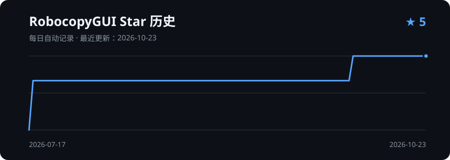

# RobocopyGUI

一个面向 Windows 的 Robocopy 图形化工具，提供分步骤操作、真实文件进度显示，以及可选的文件哈希校验功能，适合重要文件复制后的完整性确认。

## 功能

- WinUI 3 / Fluent 2 原生界面（Mica 背景），跟随 Windows 明暗主题
- 分步骤显示任务进度：路径选择、扫描、复制、校验、（剪切时）删除源文件、报告
- 复制与剪切两种模式：
  - 开启完整性校验的剪切：全部文件复制并校验一致后，才删除源文件；复制失败、校验异常或中途停止时不删除任何源文件
  - 关闭校验的剪切：使用 Robocopy `/MOVE`，复制成功后立即删除源文件；开始前会再次确认
- 基于实际字节数的复制进度，以及基于实际读取字节数的哈希校验进度
- 支持 MD5、SHA-1、SHA-256 和 SHA-512
- 支持中途停止复制或校验
- 可以把文件夹拖到窗口中设为源文件夹
- “高级参数”中显示实际执行的 Robocopy 命令
- 显示异常文件，并支持导出 CSV 报告

## 系统要求与 Robocopy

- 需要 Windows 10 1809 或更高版本、Windows 11（x64），以及系统自带的 `robocopy.exe`。
- 需要安装 [.NET 10 运行时（x64）](https://dotnet.microsoft.com/download/dotnet/10.0)（.NET Runtime 或 Windows Desktop Runtime 均可）。Windows App SDK 已随程序附带，无需另装。
- 发布版是一个 zip 压缩包，解压后运行 `RobocopyGUI\RobocopyGUI.exe`，无需安装。
- 本项目仅调用用户电脑中已有的 `robocopy.exe`，不包含、不复制、也不分发 Robocopy 或其他 Windows 系统组件。
- Robocopy 及 Windows 系统组件的权利归 Microsoft 所有，并适用其各自的许可条款。

## 构建

需要 Windows、.NET 10 SDK 和系统自带的 Robocopy。进入源代码目录后执行：

```powershell
Set-ExecutionPolicy -Scope Process Bypass
.\build.ps1
```

编译结果位于 `publish\RobocopyGUI\RobocopyGUI.exe`，同时生成可上传到 Release 的 `publish\RobocopyGUI-win-x64.zip`。构建只需要 .NET 10 SDK，不需要 Visual Studio。

开发时也可以直接构建并运行：

```powershell
dotnet build .\RobocopyGui.WinUI\RobocopyGui.WinUI.csproj -c Debug
.\RobocopyGui.WinUI\bin\Debug\net10.0-windows10.0.19041.0\win-x64\RobocopyGUI.exe
```

> 程序为免安装（unpackaged）的 x64 应用，框架依赖 .NET 10，自带 Windows App SDK 1.8（不含未使用的 Windows ML 运行库）。如需发布无需安装 .NET 的版本，可改为自包含模式；代价是体积会增大。

### 经典版（WinForms）

`RobocopyGui.csproj` 是原来的 WinForms 界面，只支持复制，与新版共用同一个 `RobocopyGui.Core`。如需构建单文件版本：

```powershell
.\build.ps1 -Classic
```

结果位于 `publish\classic\RobocopyGUI.exe`，运行需要 .NET 10 Windows Desktop Runtime（x64）。

### 测试

复制计划、Robocopy 调用和哈希校验位于不依赖界面的 `RobocopyGui.Core` 类库中。运行回归测试（需要系统自带的 Robocopy）：

```powershell
dotnet test .\tests\RobocopyGui.Core.Tests\RobocopyGui.Core.Tests.csproj -c Release
```

## 使用说明

1. 选择（或拖入）源文件夹，再选择目标文件夹。
2. 选择“复制”或“剪切”，按需开启或关闭完整性校验并选择算法。
3. 点击“开始”，观察扫描、复制、校验的真实进度；剪切会先弹出确认。
4. 查看结果和异常文件，必要时导出 CSV 报告。

> 注意：目前复制的是源文件夹“里面的内容”，不会在目标文件夹下再建一个同名文件夹，详见下方“已知问题”。

## 已知问题

以下问题已确认，计划在后续版本修复：

1. **只能选择文件夹，且不会在目标中创建同名文件夹。** 目前不能选择单个文件；复制时只把源文件夹里的内容放进目标文件夹（这是 `robocopy 源 目标` 的默认行为）。例如把 `D:\照片` 复制到 `E:\备份`，结果是 `E:\备份\2026\…`，而不是 `E:\备份\照片\2026\…`。临时办法：在目标框中直接输入 `E:\备份\照片`（不存在时会自动创建）。
2. **剪切同样不会在目标中创建同名文件夹，并且会删除源文件夹本身。** 剪切只移动源文件夹里的内容；开启完整性校验时，校验通过后还会删除已清空的源文件夹（包括源文件夹本身），看起来像整个文件夹“消失”了。计划改为与资源管理器一致：在目标中创建同名文件夹后再移动。

## 发布版本

可执行文件不放在源代码目录中，而是作为 GitHub Release 附件发布。下载程序请前往仓库的 [Releases 页面](https://github.com/J1mmyHuang/RobocopyGUI/releases)。

## 后续计划

以下为计划中的改进方向，具体实现会根据实际需求与开发进度调整：

- 修复上方“已知问题”中的两项，并支持选择单个文件；
- 支持明暗模式手动切换（目前跟随 Windows 系统主题）；
- 支持中文与英文界面切换。

## 字体致谢

本项目经典版（WinForms）界面使用 [得意黑 Smiley Sans](https://github.com/atelier-anchor/smiley-sans) 字体。字体项目由 atelier-anchor 维护，并依据 [SIL Open Font License 1.1](https://github.com/atelier-anchor/smiley-sans/blob/main/LICENSE) 发布。感谢字体作者和贡献者提供这款优秀的开源字体。

## 开发致谢

本项目的界面设计、功能实现和文档整理过程中使用了 [ChatGPT Codex](https://openai.com/codex/) 的协助。最终代码、构建结果和公开发布内容由项目维护者审阅并负责。

## 许可证

本项目采用 [Mozilla Public License 2.0 (MPL-2.0)](LICENSE)。

当你发布对本项目现有源代码文件的修改，或发布包含这些文件的可执行程序时，需保留 MPL-2.0 许可与版权声明，并以合理方式提供相应源代码。MPL-2.0 为按文件适用的弱著佐权许可证：它允许与独立文件组成更大的作品；但本项目受 MPL 覆盖的源代码文件及其修改仍须遵守 MPL-2.0。

## Star 历史



图表由本仓库的 GitHub Actions 每天自动更新。
